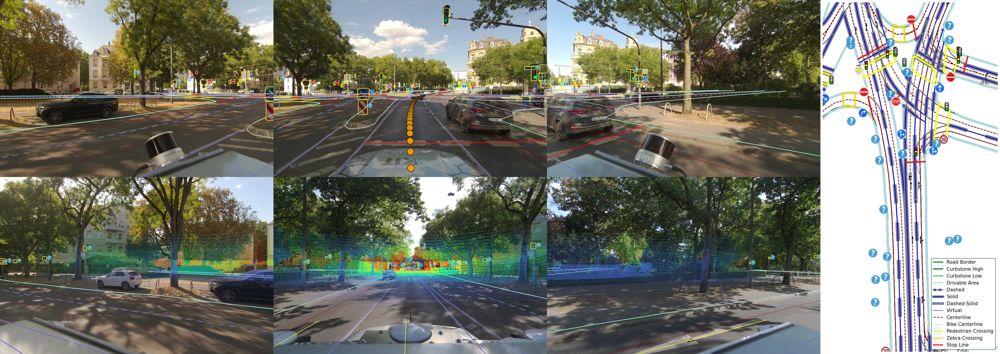

# KITScenes API

Python API for the [KITScenes Multimodal](https://huggingface.co/datasets/KIT-MRT/KITScenes-Multimodal) autonomous driving dataset.

**A high-fidelity sensor suite and the most complete HD maps of any public autonomous driving dataset.**

Nine global-shutter cameras (72.5 MPix per frame), seven long-range lidars, three 4D radars and GNSS/INS, with Lanelet2 HD maps over 62 km², recorded in Karlsruhe, Frankfurt and Sindelfingen. The `kitscenes` package loads scenes, reads synchronized sensor data, queries the HD maps, builds training samples and map labels, and downloads, visualizes and exports the data. It also reads the KITScenes Aerial extension: DOP20 orthophotos and DINOv3 feature tiles aligned with every frame.

**Links:** [Dataset website](https://kitscenes.com/multimodal/) · [KITScenes Aerial](https://kitscenes.com/aerial/) · [Download on HuggingFace](https://huggingface.co/datasets/KIT-MRT/KITScenes-Multimodal) · [Python API on GitHub](https://github.com/KIT-MRT/kitscenes) · [Changelog](CHANGELOG.md)

This is `kitscenes` **0.2.0**, an alpha release of the API for dataset release **v2.0.0** (one zip per sensor and scene; 2,079 scenes in the default split `v2.0.0_default_geosplit`). The dataset 1.0.x releases are read by the legacy kitscenes 0.1.0 ([dataset versions](docs/dataset_versions.md#legacy-dataset-v1x)). Before 1.0, minor releases of the API may change its interface; the [changelog](CHANGELOG.md) lists every change.



*Reprojection of HD map labels into 6 of the 9 cameras, with LiDAR points reprojected into the rear cameras.*

## Getting started

The default path, from nothing to a loaded scene:

1. **Install** (Linux x86_64, Python 3.9–3.13):

   ```bash
   pip install "kitscenes[map,viz] @ git+https://github.com/KIT-MRT/kitscenes.git@v0.2.0"
   ```

2. **Get access:** accept the dataset terms on [HuggingFace](https://huggingface.co/datasets/KIT-MRT/KITScenes-Multimodal) (the dataset is gated), then log in with `hf auth login`.
3. **Download the example scene** (a scene is ~20 s of driving; this one is a val scene in Frankfurt, the one the notebooks use):

   ```bash
   export KITSCENES_ROOT=/data/kitscenes                                                          # where the dataset goes; the API reads it from here
   kitscenes download "$KITSCENES_ROOT" --scenes c34c778f-ad8c-0aa9-7e1a-c86a73f887c7 --dry-run   # what it would fetch
   kitscenes download "$KITSCENES_ROOT" --scenes c34c778f-ad8c-0aa9-7e1a-c86a73f887c7             # 5.8 GB
   kitscenes info "$KITSCENES_ROOT"                                                               # what is there
   ```

   That is the scene with all its sensors, labels and HD map, the city maps and the aerial tiles of its area. More scenes, e.g. `--splits val --max-gb 10`, and the other options: [Download](docs/download.md).

4. **Load it:** the [Quickstart](#quickstart) below runs on this scene.
5. **Go further:**
   - **The whole dataset:** `kitscenes download "$KITSCENES_ROOT"` gets everything, 12.1 TB; run it with `--dry-run` first. With `--images half` the cameras are stored at half size, ~4.4 TB in all, and your code does not change: [Download](docs/download.md), [Downscaled images](docs/transcode.md).
   - **Learn the API:** the [notebooks](#notebooks-and-examples), in order.
   - **Train a model:** samples, batches and map labels in [Training](docs/training.md) and [Maps](docs/maps.md).

Scenes land under `$KITSCENES_ROOT/data/<split>/<scene_id>/`, as zips the API reads in place (nothing to extract). The HD city maps (`lanelet2_hd_maps/`) and the OpenStreetMap SD maps (`openstreetmap_sd_maps/`) come with every download, and so do the DOP20 aerial orthophotos of the selected scenes' areas (`aerial/`). The DINOv3 aerial features come with the full download; a download that selects scenes (`--splits`, `--max-gb`, ...) gets them only with `--aerial-features` (up to ~390 GB per area).

## Install options

Step 1 of [Getting started](#getting-started) is the install command (`uv pip install` works the same; numpy 1.22 or newer, numpy 2 included). For the notebooks, the examples and the viewer, install from a clone:

```bash
git clone --branch v0.2.0 https://github.com/KIT-MRT/kitscenes.git && cd kitscenes
pip install -e ".[map,viz]" jupyter      # a plain `pip install -e .` only reads and downloads
```

| Task | Install | Notes |
| ---- | ------- | ----- |
| Read sensors, poses, calibration, labels; download; SD maps (`kitscenes.sdmap`) | `kitscenes` | numpy, scipy, pyarrow, pyproj, pillow, huggingface_hub, tqdm, pyosmium (reads the PBF SD maps) |
| HD map API (`kitscenes.map`, `scene.map`) and map labels (`MLConverter`, map layer of the visualization) | `kitscenes[map]` | the KITScenes build of lanelet2 (below) |
| Plots, reprojection into the cameras, videos | `kitscenes[viz]` | matplotlib, OpenCV |
| Videos of scenes on the GPU (`kitscenes video`) | `kitscenes[video,map]` | torch, OpenCV, matplotlib; the ffmpeg binary (with NVENC for the GPU encoder) |
| Notebooks | `kitscenes[viz]` + `jupyter` | 04 and 06 to 08 also need `[map]`, 05 `[torch]`, 06 `[aerial]` and the aerial tiles |
| Training (torch tensors), GPU lidar maps, `motion_torch`, `decode` | `kitscenes[torch]` | torch>=1.13 (`decode`: torch>=1.10); install torch for your CUDA first, see [Training](docs/training.md#install) |
| NVIDIA DALI readers (`kitscenes.dali`) | `nvidia-dali` | from NVIDIA's package index, not an extra |
| `SDMap.to_networkx()` | `kitscenes[sdmap]` | networkx |
| Aerial crops and DINOv3 feature tiles (`kitscenes.aerial`) | `kitscenes[aerial]` | OpenCV (fast crops; scipy without it); reading the release tiles needs nothing extra |
| 3D viewer | `pip install -e . -e viewer` in a clone | separate distribution `kitscenes-viewer` |
| Everything above that needs no choice | `kitscenes[all]` | map, viz, aerial, sdmap (not torch, not the viewer) |
| Tests | `kitscenes[dev]` | `pytest`; tests of extras you did not install are skipped. `KITSCENES_ROOT=<root> pytest` adds the tests on real data, `KITSCENES_NOTEBOOK_ROOT=<root> pytest -m notebooks` runs the notebooks |

**The map extra and the ML converter.** `kitscenes[map]` installs lanelet2 `1.2.3+kitscenes4` (`kitscenes.map.LANELET2_BUILD`), the [KITScenes build](https://github.com/KITScenes/Lanelet2/releases/tag/1.2.3-kitscenes4) with `lanelet2.ml_converter`. Its wheels exist **only for Linux x86_64 and Python 3.9–3.13**. Elsewhere the PyPI lanelet2 is installed: the map API works, but the map labels (`MLConverter`) raise `MissingDependencyError`. `kitscenes.map.has_ml_converter()` tells which one you have. Details: [Maps](docs/maps.md#lanelet2-the-kitscenes-build).

## Quickstart

```python
import kitscenes

ds = kitscenes.open(splits="val")                    # root from $KITSCENES_ROOT
scene = ds[0]                                        # or ds["<scene uuid>"]
frame = scene[50]                                    # one 10 Hz time step
image = frame.image("camera_ring_front", reduce=4)   # (568, 876, 3) uint8 RGB
cloud = frame.lidar("lidar_top")                     # the measured points, deskewed
xyz = cloud.xyz                                      # (N, 3) float32, base frame (x forward, y left, z up)
pose = frame.pose                                    # EgoPose: xyz, quat, T_world_base
future = frame.future(horizon_s=3.0)                 # the ego trajectory ahead, in this frame's base frame
lanes = scene.map.lanes()                            # HD map lanes (not in the test splits)

spec = kitscenes.SampleSpec(cameras=("camera_ring_front",), reduce=4, lidars=("lidar_top",), future_s=3.0)
samples = kitscenes.SampleDataset(ds, spec)          # a torch Dataset; DataLoader(..., collate_fn=kitscenes.collate)
```

Anything that may be missing (a sensor you did not download, maps and labels in the test splits) raises a `kitscenes.Unavailable` that says why, or returns None with `missing="none"`.

## Which doc do I need

| I want to ... | Read |
|---|---|
| know the frames, units, timestamps, base vs road frame, missing-data errors | [Conventions](docs/conventions.md) |
| read cameras, lidars, radars, labels, calibration; ego motion and the IMU, image corrections; fuse and project | [Sensors](docs/sensors.md) |
| query the HD map, make map labels (MapTR preset) | [Maps](docs/maps.md) |
| train and evaluate map-construction models: info files, image loaders, evaluation | [The map benchmark pipeline](docs/maps.md#the-map-benchmark-pipeline) |
| use the OpenStreetMap SD maps: roads, routes, junctions, rule-based driving commands | [SD maps and navigation](docs/sdmap.md) |
| train: samples, batches, clips, GPU JPEG decoding | [Training](docs/training.md) |
| predict ego trajectories (test-e2e): submission format, metrics, ego status, driving command | [End-to-end driving](docs/e2e.md) |
| use GNSS/INS and IMU messages | [GNSS/INS](docs/gnss_ins.md) |
| build voxel maps over many frames | [Lidar maps](docs/lidar_maps.md) |
| use KITScenes Aerial: DOP20 orthophoto crops and DINOv3 feature tiles under every frame | [Aerial imagery](docs/aerial.md), [DINOv3 features](docs/aerial_features.md) |
| plot, reproject into the cameras, render videos of scenes on the GPU, use the 3D viewer | [Visualization](docs/visualization.md) |
| pick splits and scenes | [Splits](docs/splits.md) |
| use a split definition other than the default (`scene_id → split`) | [Split definitions](docs/splits.md#split-definitions) |
| filter scenes by recording metadata (week, time of day, light, weather, road types, ...) | [Scene table](docs/scene_table.md) |
| download parts, pin a version, extract | [Download](docs/download.md) |
| keep the cameras at 1/2, 1/4 or 1/8 size to save disk (`--images half`, `kitscenes transcode`), repack scenes into zips | [Downscaled images](docs/transcode.md) |
| know the dataset releases and which API reads them | [Dataset versions](docs/dataset_versions.md) |
| see what changed in the API | [Changelog](CHANGELOG.md) |

## Notebooks and examples

The notebooks in `notebooks/` are a learning path. They run on the example scene of [Getting started](#getting-started) (`SCENE_ID` in the first cell; any scene works) under `$KITSCENES_ROOT` (or set `DATASET_ROOT`). Notebook 01 says what to download. 01 to 07 follow that one scene; 08 looks at all scenes and says what it needs:

| Notebook | What it shows |
| -------- | ------------- |
| `01_quickstart.ipynb` | Open the dataset, a scene, a frame; a camera image, a lidar sweep, the ego pose and the drive; missing data |
| `02_sensors_and_calibration.ipynb` | The rig (cameras, lidars, radars), timing, transforms between frames, all lidars fused, lidar and radar in the cameras, lidar deskewing, several frames in one cloud, radar ego-motion compensation, GNSS/IMU |
| `03_labels.ipynb` | Ground segmentation, instance masks, camera labels on lidar points, availability and what the test splits withhold |
| `04_maps.ipynb` | `SceneMap` queries (lanes, lines, crosswalks, lane matching, routing), map points in the camera, ML-converter map labels top-down and in the cameras, the future drive on the map, the city maps |
| `05_training.ipynb` | `SampleSpec`, `SampleDataset` and `collate` with a `DataLoader`, ego past and future, clips, map labels in samples, speed (workers, `scene_cache`) |
| `06_aerial_imagery.ipynb` | Aerial crops per frame from the release tiles (on the fly, a tile store, a crop cache), map labels and lidar over them, the DINOv3 features as an image |
| `07_sd_maps_and_navigation.ipynb` | The OpenStreetMap SD map of a scene, the roads around a frame, the driven route with its maneuvers, the route on the HD map, driving commands (experimental) |
| `08_dataset_overview.ipynb` | All scenes: the recording conditions from the scene table, the splits and the night drives on the city maps, how much map lies around the vehicle |

Scripts in `examples/` (each says in its docstring what it shows and how to run it):

| Script | What it does |
| ------ | ------------ |
| `example_usage.py` | A tour of the whole API in one script, printing what each call returns |
| `train_loop.py` | A minimal PyTorch training loop: front camera to the next 3 s of the ego trajectory, with a masked loss |
| `export_scene.py` | A scene as PCD/PLY point clouds, JPEG images, TUM poses and calibration JSON, for other tools |
| `render_reprojection.py` | The ring cameras with map labels, lidar and radar drawn in, as JPEGs per frame and an MP4 |
| `download_subset.py` | Scenes chosen from the scene table (split, city, lidar) and the `kitscenes download` command for them |
| `download_aerial_tiles.py` | Orthophoto tiles around chosen scenes from a WMS service (another flight date, another source) into a tile folder of your own, read like the release tiles |

## License

The `kitscenes` source code is licensed under the **Apache License 2.0** ([LICENSE](LICENSE)).

The KITScenes Multimodal **dataset** is **not** covered by Apache-2.0. Access is gated on HuggingFace. By requesting access you agree to use the data under [CC BY-NC 4.0](https://creativecommons.org/licenses/by-nc/4.0/) together with the additional KITScenes terms on the [dataset page](https://huggingface.co/datasets/KIT-MRT/KITScenes-Multimodal). Where those dataset terms conflict with CC BY-NC 4.0, the dataset terms prevail. Using this Python API does **not** grant rights to use the dataset beyond those terms.

Three parts of the release have their own terms: the DOP20 orthophotos in `aerial/` (open data of the state surveying agencies of Baden-Württemberg and Hesse, `aerial/ATTRIBUTION.md`), the DINOv3 feature tiles in `aerial/features/` (their `TERMS.md` and Meta's DINOv3 licence; the dataset terms you accept on HuggingFace cover them too: the source imagery must not be reconstructed from them) and the OpenStreetMap SD maps in `openstreetmap_sd_maps/` (© OpenStreetMap contributors, [ODbL 1.0](https://opendatacommons.org/licenses/odbl/1-0/)).

## Citation

If you use KITScenes Multimodal in research, please cite [The Road Ahead in Autonomous Driving: The KITScenes Multimodal Dataset](https://arxiv.org/abs/2606.02956) (arXiv:2606.02956). If you use the aerial imagery or the DINOv3 aerial features, please also cite [A Unified Benchmark for Aerial-Enhanced Autonomous Driving: The KITScenes Aerial Dataset](https://arxiv.org/abs/2610.40455) (arXiv:2610.40455).

```bibtex
@misc{schwarzkopf2026kitscenes,
      title={The Road Ahead in Autonomous Driving: The KITScenes Multimodal Dataset}, 
      author={Richard Schwarzkopf and Fabian Immel and Alexander Blumberg and Jonas Merkert and Nils Rack and Kaiwen Wang and Fabian Konstantinidis and Julian Truetsch and Carlos Fernandez and Annika Bätz and Kevin Rösch and Marlon Steiner and Willi Poh and Yinzhe Shen and Royden Wagner and Felix Hauser and Dominik Strutz and Jaime Villa and Gleb Stepanov and Holger Caesar and Ömer Şahin Taş and Frank Bieder and Jan-Hendrik Pauls and Christoph Stiller},
      year={2026},
      eprint={2606.02956},
      archivePrefix={arXiv},
      primaryClass={cs.CV},
      url={https://arxiv.org/abs/2606.02956}, 
}
```

```bibtex
@misc{lengerer2026kitscenesaerial,
  title     = {A Unified Benchmark for Aerial-Enhanced Autonomous Driving: The KITScenes Aerial Dataset},
  author    = {Daniel Lengerer and Richard Schwarzkopf and Jonas Merkert and Fabian Immel and
               Rupert Polley and Frank Bieder and Jan-Hendrik Pauls and J. Marius Zöllner and
               Klaus Bogenberger and Christoph Stiller and Carsten Markgraf},
  year      = {2026},
  eprint    = {2610.40455},
  archivePrefix = {arXiv},
  primaryClass  = {cs.CV},
  url       = {https://arxiv.org/abs/2610.40455}
}
```
