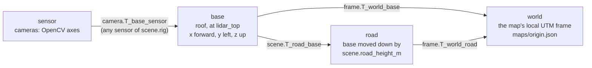

# Conventions

Time, coordinate frames, units, names and missing data, for the whole API. The notebooks show the same on real data.

**In short**

- Times are integer nanoseconds since the scene start (`t_ns`). Frames are 10 Hz.
- Points come in the vehicle **base frame** at the frame time: on the roof, x forward, y left, z up. The **road frame** is the base frame moved down onto the road; the map benchmark uses it.
- Transforms are (4, 4) matrices named `T_<to>_<from>`.
- Missing data raises a `kitscenes.Unavailable` whose `state` says why, or returns None with `missing="none"`.

```python
cloud = frame.lidar("lidar_top")                  # base frame (default)
road = frame.lidar("lidar_top", frame="road")     # road frame: z ≈ 0 on the road
world = frame.lidar("lidar_top", frame="world")   # the map's frame
```



Each arrow maps points from one frame into the other. In the test-e2e splits the world frame is relative to the first pose.

**Contents:** [Time](#time) · [Coordinate frames](#coordinate-frames) · [The road frame](#the-road-frame) · [Transforms](#transforms) · [Poses](#poses) · [Missing data](#missing-data) · [Names and units](#names-and-units) · [Public API](#public-api)

## Time

- Times are integer nanoseconds since the scene start, named `t_ns`: `frame.t_ns`, `EgoPose.t_ns`, `scene.ego(t_ns)`, `EgoTrajectory.t_ns`, the `t_ns` column of `scene.messages()`. `frame.t_s` is the same in seconds.
- Frames are 10 Hz. Frame `i` of every sensor belongs to `scene.timestamps_ns[i]`. The release stores the times as decimal seconds (9 decimals, exact; 0 is the scene's earliest measurement); the API parses them exactly.
- `frame.token` is `"<scene id>_<index:04d>"` (the frame index, four digits: `"17a14cb5-4d50-727b-ae2a-5c15d88be042_0007"`), the frame's ID in info files, evaluation GT, predictions and submissions. Take nothing from it but the scene id (`token.rsplit("_", 1)[0]`); the frame time is `frame.t_ns`.
- The lidar's per-point `timestamp` column is in seconds since the scene start, as stored (`cloud.point_t_ns` in ns).

**Timing edge cases**

- A sensor can miss frames: `scene.frame_indices(sensor)` lists the frames it has; the others raise with state `DROPPED`. This does not occur in dataset v2.0.0: every scene has all 19 sensors for every frame and one pose per frame.
- A lidar sweep spans up to 0.1 s around the frame time: Hesai `lidar_top` 0 to +100 ms, Velodyne `lidar_top` about ±50 ms, the other lidars 0 to +95 ms. Deskewing moves every point to the frame time.
- A radar cloud is captured about 18 ms before the frame time (`radar.capture_t_ns`) and compensated to it.
- `poses.txt` normally has one pose within 0.05 ms of each frame time. `scene.ego(t_ns)` interpolates between poses and extrapolates at most 0.2 s beyond the first and last one. It refuses pose intervals longer than 0.2 s (`PoseUnavailable`); `frame.future()` / `past()` mark such slots not `valid`.

## Coordinate frames

| Frame | `frame=` | Axes | Origin |
|---|---|---|---|
| base (default) | `"base"` | x forward, y left, z up | on the roof, at the top lidar, about 2.05 m above the road; at the frame time |
| road | `"road"` | same as base | the base frame moved down onto the road (z ≈ 0 on the road under the vehicle) |
| sensor | `"sensor"` | the sensor's own | the sensor |
| world | `"world"` | the map's local UTM frame (`maps/origin.json`) | the frame of the poses |
| camera | — | OpenCV: x right, y down, z forward | the camera |

- Points are in the vehicle's **base frame at the frame time**, ego-motion compensated (`cloud.motion_compensated`). Without usable poses they are only transformed; `cloud.reason` says why.
- The keyword `frame=` always means a coordinate frame. The methods take those that make sense for them: `lidar` and `radar` all four, `fused_lidar` and `scene.accumulate` base, road and world, `future`, `past`, `lidar_deskew_inputs`, `SampleSpec` and `MapLabelSpec.labels` base and road, `scene.imu` the IMU's own (`"imu"`) or base.
- `EgoTrajectory.xyz_ego` and `MLConverter` labels are in the base frame at the frame time. For the road frame use `frame.future(frame="road")`. Training samples are in the base frame by default too; `SampleSpec(frame="road")` puts them in the road frame, the frame of the map benchmark, whose preset `MapLabelSpec.maptr()` says so (`frame="road"`; `MapLabelSpec.labels(frame)` then lifts the labels, `labels(frame, frame="base")` keeps the base frame).

## The road frame

`frame="road"` is for models and configs that expect the ego frame on the ground, like the ego frames of nuScenes and Argoverse 2 (BEV z ranges, 3D map labels at road level). It is the base frame moved down by `scene.road_height_m`, rigid with the vehicle: `scene.T_road_base`, `frame.T_world_road`.

`scene.road_height_m` is a constant of the vehicle per lidar generation (`kitscenes.constants.ROAD_HEIGHT_M`): 2.055 m (Hesai) and 2.040 m (Velodyne), 2.05 m for a scene the scene table does not list. How it was measured:

- on the ground-labelled `lidar_top` points in the vehicle's own lane, 3–12 m ahead and behind, |y| < 2.5 m;
- a robust plane per frame, its height below the base origin, the median over the frames of a scene;
- over 25 Hesai and 27 Velodyne scenes (train and val, all three cities) the scene medians are 2.056 ± 0.011 m and 2.038 ± 0.010 m. Single frames scatter by about ±3 cm (suspension, road camber), so a per-scene estimate gains nothing. The constant also holds in the test splits, which ship no ground labels.

The road is at z ≈ 0 below the vehicle. Ahead it leaves z = 0 where the slope changes (crests, dips, ramps): the frame is not fitted to the road at each frame.

`frame="road"` works in `frame.lidar`, `fused_lidar`, `radar`, `lidar_deskew_inputs`, `future`, `past`, `scene.accumulate` and `SampleSpec`. For `MLConverter` labels outside samples, add the height to z: `transform_points(scene.T_road_base, xyz)`, or use `MapLabelSpec.labels(frame)`.

The map benchmark (`kitscenes-map-converter`, `kitscenes-map-eval`) is in the road frame. A submission in the base frame states `"meta": {"ego_frame": "base"}` and is converted by the evaluator; in 3D an unstated base-frame submission stops with an error instead of scoring 0.

## Transforms

(4, 4) matrices named `T_<to>_<from>`:

- `T_world_base` maps base-frame points into the world frame.
- `camera.T_base_sensor` maps camera-frame points into the base frame; `camera.T_sensor_base` is the reverse.
- `scene.T_road_base` maps base into road (a z shift by `scene.road_height_m`).
- `frame.T_world_road` is the pose of the road frame.

Helpers: `kitscenes.transform_points(T, xyz)`, `kitscenes.invert_transform(T)`.

## Poses

- `scene.track`: the recorded lines of `poses.txt` as arrays (`t_ns`, `xyz`, `quat`), with the map origin; `track.pose(i)` is one of them.
- `scene.ego(t_ns)`: the interpolated pose and motion at any time.
- `frame.pose` / `frame.T_world_base`: at the frame time.
- `scene.ego()`, `frame.pose`, deskewing and the map labels use `scene.ego_motion`: the poses interpolated, with the rotations refined by the gyro where the scene has IMU data and a valid `gnss_ins_imu` calibration (`ego_motion.source`, [Sensors](sensors.md#calibration-and-fusion)). In release v2.0.0 that is every scene except the test-e2e splits, which ship no GNSS/INS and use the poses alone. `scene.track` stays as stored; `kitscenes.open(use_imu=False)` turns the refinement off.
- All of these are poses of the base frame. For the road frame: `frame.T_world_road`, or `T_world_base @ invert_transform(scene.T_road_base)`.
- Poses are in the map's local UTM frame (`maps/origin.json`), except in the test-e2e splits, where they are relative to the first pose (`scene.pose_frame`).

## Missing data

Missing data raises a `kitscenes.Unavailable` (`SensorUnavailable`, `LabelsUnavailable`, `MapUnavailable`, `PoseUnavailable`, `AerialUnavailable`). Its `state` says why:

| State | Meaning |
|---|---|
| `NOT_IN_RELEASE` | labels the release does not cover: instance masks of the side cameras |
| `NOT_DOWNLOADED` | not in this copy, e.g. a sensor left out of a partial download (every scene has all 19 sensors); the message names the download command |
| `DROPPED` | none for this frame. Does not occur in dataset v2.0.0: every scene has all 19 sensors and a pose for every frame, and every frame outside the test-e2e splits has an aerial crop. A pose asked for at a time outside the scene is still `DROPPED` |
| `WITHHELD_BY_SPLIT` | maps and labels in the test splits; GNSS and aerial crops in the test-e2e splits |
| `INVALID` | e.g. a label file that does not fit its sweep |
| `NOT_INSTALLED` | lanelet2 for the map |
| `NOT_PREPARED` | aerial crops |

- The accessors that read data of a frame take `missing="none"` to return None instead: `frame.image`, `image_bytes`, `sensor_file`, `lidar`, `lidar_deskew_inputs`, `ground_mask`, `instances`, `radar`, `future`, `past`, `aerial`, `aerial_features`, and `scene.messages`, `scene.imu`. `frame.fused_lidar(missing="none")` leaves out the lidars without a sweep. `frame.pose`, `frame.ego`, `scene.ego`, `frame.navigation` and the maps (`scene.map`, `scene.sd_map`) always raise. Type checkers see an `Optional` result only for `missing="none"` (`kitscenes.errors.Missing`).
- Ask first with `scene.availability(what, index)` / `frame.availability(what)`, for a sensor name, `"ground_labels/<lidar>"`, `"instances/<camera>"`, `"map"`, `"pose"`, `"aerial"`, `"aerial_features"` or `"<gnss device>/<topic>"` (`"gnss_ins/imu"`; an unknown topic is a `KeyError`).
- A broken `calibration/calib.json` (not valid JSON, an invalid entry, or no entry for a sensor with data) is not missing data: `scene.rig`, and so every lidar and radar accessor, raises one `kitscenes.CalibrationError`.

## Names and units

- Times `t_ns` (`t_s` in seconds), frame positions `index`, transforms `T_<to>_<from>`, points `xyz` (`xyz_ego`, `xyz_world` where the frame needs saying), orientations `quat` (qx, qy, qz, qw).
- Units as suffixes otherwise: `duration_s`, `speed_limit_mps`, `cache_mb`.
- Units: metres, seconds, m/s, radians; the maps' speed limits also in km/h (`speed_limit_kph`, as on the signs).
- Sensor names: see [Sensors](sensors.md#sensor-names).

## Public API

Public are the names in `__all__` of `kitscenes` (plus `kitscenes.open`) and of the subpackages and modules the docs name: `kitscenes.map`, `.sdmap`, `.aerial`, `.visualization`, `.navigation`, `.e2e`, `.decode`, `.dali`, `.mapping`, `.accumulate`, `.ego_trajectory`, `.motion_torch`, `.splits`, `.export`, `.transcode` and `.errors`. Everything else, with or without a leading underscore, may change.
