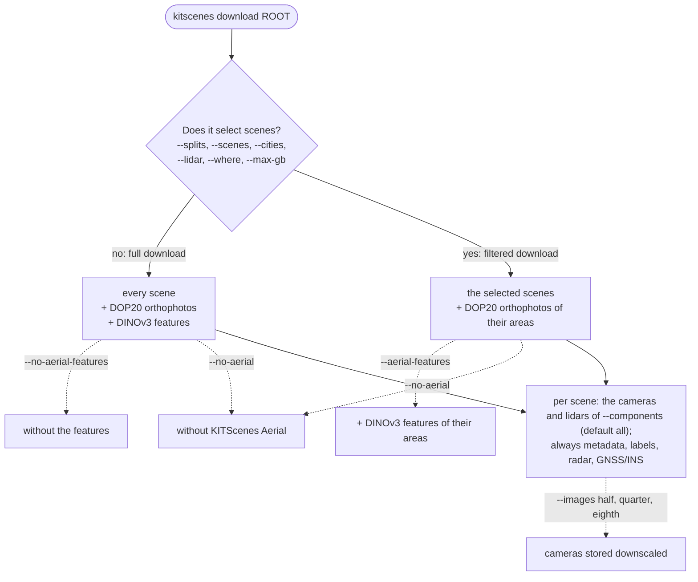

# Download in detail

How to get all of KITScenes or parts of it with `kitscenes download`, what a download contains and how the files are laid out.

**In short**

- The dataset is gated: accept its terms on [HuggingFace](https://huggingface.co/datasets/KIT-MRT/KITScenes-Multimodal) and log in once with `hf auth login`.
- `kitscenes download "$KITSCENES_ROOT"` gets everything: 12.1 TB, every scene with all sensors, the maps and KITScenes Aerial.
- A partial download leaves out cameras and lidars only (98 % of the data). Metadata, labels, radar, GNSS/INS and the maps always come along.
- The DINOv3 aerial features (0.66 TB) come with the full download. A download that selects scenes gets them only with `--aerial-features`.
- The API reads the zips in place. Nothing needs to be extracted.

```bash
kitscenes download "$KITSCENES_ROOT" --splits val --dry-run    # what it would fetch, and the sizes
kitscenes download "$KITSCENES_ROOT" --splits val              # the val scenes
```

What a download includes:



The HD city maps and the SD maps come with every download. `--components` and `--images` do not select scenes.

**Contents:** [Download and read the zips](#download-and-read-the-zips) · [Partial downloads](#partial-downloads) · [KITScenes Aerial](#kitscenes-aerial) · [Layout](#layout) · [Versions](#versions) · [Downscaled images](#downscaled-images-save-disk) · [Alternatives](#alternatives)

## Download and read the zips

```bash
kitscenes download "$KITSCENES_ROOT"                                          # everything: every scene, all sensors, KITScenes Aerial (~12.1 TB)
kitscenes download "$KITSCENES_ROOT" --no-aerial-features                     # everything but the DINOv3 aerial features (~11.4 TB)
kitscenes download "$KITSCENES_ROOT" --scenes c34c778f-ad8c-0aa9-7e1a-c86a73f887c7  # one scene: the example scene of the notebooks (5.8 GB)
kitscenes download "$KITSCENES_ROOT" --splits val --components ring-cameras    # e.g. only the six ring cameras of val (+ the aerial tiles of its areas)
kitscenes download "$KITSCENES_ROOT" --splits val --aerial-features            # val with the DINOv3 features of its areas
kitscenes download "$KITSCENES_ROOT" --splits train --max-gb 50 --dry-run      # sizes first
kitscenes download "$KITSCENES_ROOT" --cities Karlsruhe --lidar hesai          # by city and lidar generation (scene table)
kitscenes download "$KITSCENES_ROOT" --cities Karlsruhe --components none --aerial-features  # KITScenes Aerial of Karlsruhe (+ the small files of its scenes)
kitscenes download "$KITSCENES_ROOT" --where weather=rain --where dark=true    # by any column of the scene table (scene_table.md)
kitscenes info "$KITSCENES_ROOT" -v                                            # what is there
```

- The API reads the zips directly: nothing to extract or mount.
- `kitscenes.open(root, verify=True)` also checks the CRC-32 of every member it reads (about 25 % of one core per read), if you distrust the storage. A mismatch raises `kitscenes.errors.ChecksumError` (a `DataFormatError`, not an `OSError`), and so does a zip that ends before a member does (a truncated download): download the scene again.
- Files come **8 at a time** (`--jobs`) over HuggingFace's Xet transfer, straight into place.
- Each file is **checked by its size** against the manifest, which catches incomplete downloads without reading anything back. `--verify` checks SHA-256 instead (about +65 % time).
- Running `download` again fetches only what is missing. The exit code is 1 if anything failed.
- `examples/download_subset.py` picks scenes from the scene table (split, city, lidar) and prints the `kitscenes download` command for them.

## Partial downloads

**A partial download leaves out only cameras and lidars**, which are 98 % of the data. Everything else always comes along (~20 MB per scene), so whatever reads a scene keeps working: the metadata (timestamps, poses, calibration, the scene's HD map), the labels (ground segmentation, instance masks), radar, GNSS/INS, IMU, the HD city maps and the SD maps (the weekly snapshots and the paper's 2026-05-03 snapshots; [SD maps](sdmap.md#data-and-licence)). KITScenes Aerial comes along by area, not by scene: see [below](#kitscenes-aerial).

`--components` takes camera/lidar names or presets:

| Preset | Components | Per scene (release average) |
|---|---|---|
| `all` (default) | all cameras and lidars | ~5.5 GB |
| `cameras` | the 9 cameras | ~4.4 GB |
| `ring-cameras` | the 6 ring cameras | ~2.6 GB |
| `base-cameras` | the 3 base cameras (front center + rectified stereo) | ~1.8 GB |
| `front-camera` | `camera_ring_front` | ~0.4 GB |
| `lidars` | the 7 lidars | ~1.05 GB |
| `lidar-top` | `lidar_top` | ~0.54 GB |
| `none` | no cameras or lidars | ~0.02 GB |

`--max-gb` keeps whole scenes, in order, while the total fits, the aerial tiles included (see below).

Everything that needs a sensor you left out says so, with the command that gets it: `SensorUnavailable`, state `NOT_DOWNLOADED`, e.g. `kitscenes download <root> --scenes <id> --components lidar_top`. `Dataset.frames(require=...)` and `SampleDataset` raise instead of returning no frames.

## KITScenes Aerial

[KITScenes Aerial](aerial.md) comes by area: the zips of the 10 km areas that hold a selected scene, with the aerial metadata (and the feature terms, with the features) in `aerial/`.

- **DOP20 orthophoto tiles** (`aerial/raw_tiles/`, ~2 GB for the three areas, 0.3–1.3 GB per area): with every download, full or filtered. `--no-aerial` leaves them out (and the features).
- **DINOv3 feature tiles** (`aerial/features/`, ~657 GB for the three areas, 104–393 GB per area): with the full download, where `--no-aerial-features` leaves them out. A filtered download (`--splits`, `--scenes`, `--cities`, `--lidar`, `--where`, `--max-gb`) leaves them out unless you add `--aerial-features`; it prints a line with the size they would add.
- `--components` and `--images` do not select scenes: `kitscenes download "$KITSCENES_ROOT" --components ring-cameras` is a full download and gets the features.

| Command | Includes | Size |
|---|---|---|
| `kitscenes download "$KITSCENES_ROOT"` | everything | 12.1 TB |
| `… --no-aerial-features` | every scene, the aerial tiles | 11.4 TB |
| `… --no-aerial` | every scene | 11.4 TB |
| `… --components ring-cameras` | every scene with its ring cameras only, KITScenes Aerial | 6.1 TB |
| `… --splits val` | the val scenes, the aerial tiles of their areas | 1.32 TB |
| `… --splits val --aerial-features` | + the features of the val areas (all three) | 1.98 TB |

- The test-e2e splits get no aerial crops (poses relative to the first pose), so their scenes pull no area; an area comes when another selected scene lies in it.
- `--max-gb` counts KITScenes Aerial: an area's tiles (and, with `--aerial-features`, then its features) count with the first kept scene of the area, each only if it still fits. What does not fit is left out (a line says what and how much), the scenes are kept.
- `--components` chooses cameras and lidars only; KITScenes Aerial has its own flags. `--aerial-features` with `--no-aerial-features` or `--no-aerial` is an error too.
- `--images half` and the other recipes change only the cameras; the aerial zips are fetched as released.
- `kitscenes extract` unzips the aerial zips of the selected areas too, with the same rules and flags. A root without (some of) KITScenes Aerial is a normal root: `kitscenes info` lists what is there.
- Terms: the DOP20 tiles are third-party open data under their own licences (`aerial/ATTRIBUTION.md`); the feature tiles come with their own terms (`aerial/features/<set>/TERMS.md`) and Meta's DINOv3 licence, and the dataset terms you accept on HuggingFace cover them: the source imagery must not be reconstructed from them.

## Layout

```text
$KITSCENES_ROOT/
├── dataset_info.json                    the pinned revision (written by kitscenes download)
├── data/
│   ├── sequence_archives.csv            the manifest: one row per file
│   └── <split>/<scene_id>/
│       ├── timestamp.reference.txt      loose metadata
│       ├── poses.txt
│       ├── calibration/calib.json, calibration/image_corrections.json
│       ├── maps/map.osm, maps/origin.json   the scene's HD map (not in the test splits)
│       ├── index.parquet                every member of the scene's zips
│       ├── camera_<name>.zip (9), lidar_<name>.zip (7)
│       ├── radar.zip, gnss.zip, gnss_ins.zip    the three radars; one Parquet file per message topic
│       └── processed_ground_segmentation.zip, processed_seamseg_instances.zip
├── lanelet2_hd_maps/<City>.osm          the HD city maps
├── openstreetmap_sd_maps/               the SD maps (OpenStreetMap)
└── aerial/                              KITScenes Aerial
    ├── ATTRIBUTION.md, metadata/
    ├── raw_tiles/dop20_res020_tile2048/<area>.zip
    └── features/<set>/<area>.zip, TERMS.md
```

- The zips store every file uncompressed. In the camera and lidar zips every member starts at a 4 KB-aligned offset, so NVIDIA DALI reads cameras straight from them (`kitscenes.dali.write_camera_indices`).

## Versions

- `--revision` takes a release tag, a branch or a commit (`kitscenes download "$KITSCENES_ROOT" --revision v2.0.0`). Without it, a new root gets the latest release.
- The first download pins the revision (as its commit) in `$KITSCENES_ROOT/dataset_info.json`, with the manifest's SHA-256 and the archive format. Later downloads use it even when the dataset moves on.
- Another `--revision` is refused (exit code 2). `--update` moves the whole root to it:
  - every file whose SHA-256 in the new manifest differs from the root's manifest is removed: a zip, a loose file or an extracted component, also outside your selection, since the API would read it as data of the new revision;
  - the selected ones are downloaded again (and extracted again if they were).
- `--update --dry-run` lists the changed files and changes nothing.
- Dataset releases before 2.0 are refused ([Legacy: dataset v1.x](dataset_versions.md#legacy-dataset-v1x)).

## Downscaled images: save disk

The cameras are 9.2 of the 11.4 TB of scene data. If you train at a fraction of their resolution, keep them at 1/2 (JPEG q90, 4:2:0; about 6× smaller: all scenes in ~3.7 TB, ~4.4 TB with KITScenes Aerial), 1/4 or 1/8:

```bash
kitscenes download "$KITSCENES_ROOT" --splits train --images half      # while downloading: each camera zip is staged, transcoded, deleted
kitscenes transcode "$KITSCENES_ROOT" --images half                     # after a download, in place
kitscenes transcode "$SHARED_COPY" --out "$KITSCENES_ROOT" --images quarter  # into a new root; the source is only read
```

The root remembers the recipe for later downloads, `--staging-gb` (default 32) bounds the disk used for camera zips waiting to be transcoded, and `--images original` brings back the release's images. Your code does not change: `calib.json` stays as released and `scene.rig` describes the stored images. Details, sizes and quality: [transcode.md](transcode.md).

## Alternatives

- **Plain folders:** `kitscenes download ... --extract`, or `kitscenes extract "$KITSCENES_ROOT"` afterwards, unzips the components into the scene folders. Each zip is checked against the manifest's SHA-256 first, then extracted to a staging folder and moved into place. A marker remembers the archive's hash, so the next `download` does not fetch it again. Only worth it for tools that want files on disk; the API is as fast on the zips. `kitscenes pack SRC --out DST` turns extracted scenes back into the archive format.
- **Mirroring with `hf download`:** the files land in the same layout, so `kitscenes` reads them as they are, e.g. `hf download KIT-MRT/KITScenes-Multimodal --repo-type dataset --local-dir "$KITSCENES_ROOT" --include "data/val/*" --max-workers 16`. `kitscenes download` adds the selection by sensor, the size checks and the version pin.
