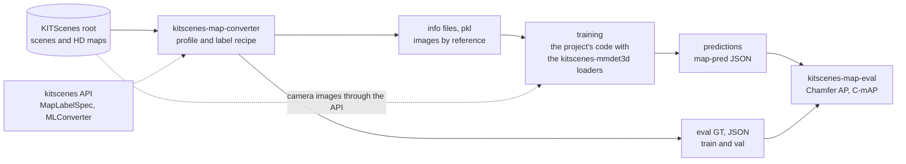

# Maps and map labels

HD map queries (`kitscenes.map`), map labels for learning (`MLConverter`) and the MapTR preset. Needs `kitscenes[map]` ([install options](../README.md#install-options)). Notebook: `04_maps.ipynb`.

**In short**

- `scene.map` gives the scene's Lanelet2 HD map as typed numpy elements (lanes, lines, signs, ...). The test splits ship no maps.
- `MLConverter` turns the map around a pose into vector labels (polylines, crosswalks, traffic elements, lane topology), in the base frame.
- `MapLabelSpec.maptr()` is the preset of the map benchmark: `divider`, `ped_crossing`, `boundary`, 60 × 30 m, 20 points, road frame.
- Map labels need the KITScenes build of lanelet2, which `kitscenes[map]` installs on Linux x86_64 with Python 3.9–3.13.
- Two label recipes: `"default"` for new work, `"paper-v2.0.0"` to reproduce the paper's labels.

```python
lanes = scene.map.lanes()                                   # the HD map
labels = kitscenes.MapLabelSpec.maptr().labels(frame)       # benchmark labels of one frame, road frame
```

**Contents:** [The map benchmark pipeline](#the-map-benchmark-pipeline) · [lanelet2: the KITScenes build](#lanelet2-the-kitscenes-build) · [Map API](#map-api) · [Map labels](#map-labels) · [Lane segments and topology](#lane-segments-and-topology) · [MapTR preset](#maptr-preset) · [Labels as in samples](#labels-as-in-samples) · [Options](#options) · [Label recipes](#label-recipes) · [Near the test regions](#near-the-test-regions)

## The map benchmark pipeline

To train and evaluate a map-construction model (MapTR, MapQR, StreamMapNet, ...), three packages work around this API:



- [kitscenes-map-converter](https://github.com/KIT-MRT/kitscenes-map-converter) writes the info files of the projects (a **profile** per project: `benchmark`, `mapqr`, `sdtagnet`, `afmn`) and the eval GT, with the labels of this page (a **label recipe**: `default` or `paper-v2.0.0`). Info files name images by scene, frame and camera, not by path.
- [kitscenes-mmdet3d](https://github.com/KIT-MRT/kitscenes-mmdet3d) is the image loader of the mmdet3d projects: it reads the camera JPEGs through this API, from any copy of the release (zips, extracted, downscaled).
- [kitscenes-map-eval](https://github.com/KIT-MRT/kitscenes-map-eval) scores predictions against the eval GT (MapTR's Chamfer AP; C-mAP for tracking). The test GT is not published.
- Everything is in the road frame, on the scored frames of the default split `v2.0.0_default_geosplit` (every 4th frame, 2.5 Hz).

## lanelet2: the KITScenes build

`kitscenes[map]` installs lanelet2 `1.2.3+kitscenes4` (`kitscenes.map.LANELET2_BUILD`) from the [KITScenes/Lanelet2 releases](https://github.com/KITScenes/Lanelet2/releases/tag/1.2.3-kitscenes4): wheels for Linux x86_64, Python 3.9–3.13, pinned by URL (pip and uv both resolve it). It is upstream lanelet2 1.2.3 plus:

- `lanelet2.ml_converter`, which the map labels need;
- opt-in lane changes across bicycle lanes in routing ([Lanelet2 pull request #434](https://github.com/fzi-forschungszentrum-informatik/Lanelet2/pull/434));
- a converter `MapData` that can be processed for one box after another (what `chaining="scene"` needs);
- classes of their own for bicycle lane markings (`type=bike_marking`): `BikeMarkingDashed` and `BikeMarkingSolid` in the `"default"` and `"road_border_merged"` groupings. The paper's build 1.2.3+kitscenes3 labels them `Dashed`, `Solid` or `Unknown`; the `"maptr"` and `"m3tr"` groupings are the same with both builds.

The labels of the v2.0.0 paper runs were made with 1.2.3+kitscenes3 (`kitscenes.map.LANELET2_PAPER_BUILD`); the label recipe `"paper-v2.0.0"` needs exactly that build ([Label recipes](#label-recipes)).

On other platforms or Python versions the PyPI lanelet2 is installed instead: the map API works, the map labels and the lane changes across bicycle lanes do not. `kitscenes.map.has_ml_converter()` tells which one you have. Without the converter, `MLConverter` raises `MissingDependencyError`. The camera projection (`kitscenes.projection`, `kitscenes.map.project_to_camera`) does not need it.

## Map API

Scenes of the train, val and overlap splits ship a Lanelet2 HD map in the frame of their poses. The test splits have none (`MapUnavailable`, state `WITHHELD_BY_SPLIT`). `kitscenes.map` turns the map into typed numpy elements:

- lanes: kind, boundaries, centerline, speed limit in m/s (`speed_limit_mps`; `speed_limit_kph` in km/h), successors, neighbours;
- lines: curbs, markings, poles, ...;
- stop lines, traffic signs and lights (unknown heights are NaN).

```python
from kitscenes.map import Circle, Region, project_to_camera

smap = scene.map                                  # raises kitscenes.MapUnavailable in the test splits (state WITHHELD_BY_SPLIT)
region = Region(ahead=60, behind=20, left=20, right=20)   # a rectangle around the vehicle
box = region.around(frame.pose)                   # placed at the pose: a Box in the map frame
lanes = smap.lanes(box, kinds=["road"])           # or Circle.around(frame.pose, 50); no region = whole map
matches = smap.match(frame.pose)                  # lanes the vehicle is on, heading-aware
patch = smap.query(box).in_ego(frame.pose)        # everything in the vehicle frame
uv, depth, visible = project_to_camera(lanes[0].left_points, frame.pose, scene.rig.cameras["camera_ring_front"])
smap.lanelet_map, smap.routing_graph              # the lanelet2 objects, if you need them
```

- `smap.drivable_lanes()`: the lanes a vehicle may use (their footprint, not the full space up to the curbs).
- City maps in the dataset's top-level `lanelet2_hd_maps/` folder (`ds.city_maps()`) load in a scene's frame with `scene.load_map(path)`.

## Map labels

Map labels for learning come from `lanelet2.ml_converter` (the KITScenes build, above), as numpy arrays in the vehicle frame:

- lane lines chained across the splits of the annotation into compound lines: dividers, road borders, centerlines, crosswalks, drivable-space borders;
- traffic elements: stop lines, arrows, symbols, lights, signs;
- the edges between them.

```python
from kitscenes.map import MLConverter, Region, Spacing, Adaptive

conv = MLConverter.for_scene(scene, grouping="m3tr", region=region)   # the same Region as the map queries
labels = conv(frame.pose)          # 3D by default (dims=2: the converter's 2D mode)
labels.lines["Dashed"]             # list of (N, 3) arrays; labels.line_ids: the map elements behind each
                                   # every type of the grouping is a key, [] where there is none
labels.line_keys("Dashed")         # ("Dashed", member ids, piece) per line: the element's key
labels.traffic_elements["StopLine"], labels.te_to_centerline, labels.te_to_te
labels.map_changed                 # True in map_change scenes: the map differs from the road, on purpose
MLConverter(scene.map, sampling=Spacing(1.0))      # a point per metre instead of 20 per line;
MLConverter(scene.map, sampling=Adaptive(0.05, 5)) # or the map's vertices, thinned on straights; None: as mapped
```

- `grouping` is the converter's label set: `"default"`, `"road_border_merged"`, `"maptr"`, `"m3tr"`. The types of each are in `kitscenes.map.GROUPING_CLASSES`.
- Labels are in the base frame at the frame time. The converter's own rotation into the vehicle frame is off by centimetres to metres wherever the vehicle pitches or rolls; `MLConverter` compensates (exact to 1e-14 m).
- Lines, crosswalk polygons and lane segments are cut exactly to the region in the label frame's x-y. Pieces shorter than 0.1 m and crosswalk polygons under 1 m² are dropped. Where the converter itself cuts a line short (on hills), it can end up to ~1 m before the border.
- `MLConverter` pickles, so it can live in DataLoader workers. 4–11 ms per 60 × 30 m label set (about 15 ms with lane segments).
- For the road frame add the road height to z: [Conventions](conventions.md#the-road-frame). Map labels in training samples: [Training](training.md#map-labels-in-samples).

## Lane segments and topology

Every label set also has the **lane segments** with their successor graph, for lane-graph models (TopoNet, LaneSegNet):

```python
labels = conv(frame.pose)
labels.lane_segments               # list of (N, 3) arrays: lane centerlines between branch points
labels.lane_segment_ids            # the lanelet ids of each segment's whole run: the same in every frame
labels.lane_segment_pieces         # which piece of its run each segment is (0, 1, ... along it)
labels.lane_to_lane                # [(i, j)]: segment j follows segment i
```

- A lane segment is a run of lanelets where each has exactly one successor and that one exactly one predecessor, in the lanelets' direction. A bidirectional lanelet counts once, in its own direction. Segments are clipped by the region and the height filter like the lines.
- `(i, j)` in `lane_to_lane`: j's first lanelet is a successor of i's last lanelet, or i and j are consecutive pieces of one run that the region or the height filter cut (they need not touch).
- The converter's centerlines (`Centerline`, MapTRv2's `centerline` class) are different: paths through the region, one per way through it, overlapping. A successor graph between them would be empty.
- Traffic elements have their own edges: `labels.te_to_centerline`, `labels.te_to_te`.

## MapTR preset

`kitscenes.MapLabelSpec.maptr()` is the preset for the MapTR family (MapTR, MapTRv2, StreamMapNet, MapQR, MapTracker):

- classes `divider` (lane and bike-lane markings), `ped_crossing` and `boundary` (the drivable-space border, the closest match to the AV2 and nuScenes boundary); with `centerline=True` also `centerline` (MapTRv2);
- the 60 × 30 m box around the vehicle (`Region()`), 20 points per element, 3D;
- the frame: `spec.converter(scene)(pose)` (an `MLConverter`) gives the base frame; the preset is for the road frame (`frame="road"`, z = 0 on the road under the vehicle; the frame of the map benchmark): `spec.labels(frame)` and samples with `SampleSpec(frame="road")` lift the 3D labels, and a sample in another frame raises `ValueError`. `spec.labels(frame, frame="base")` keeps them in the base frame; `MapLabelSpec.maptr(frame=None)` follows the sample's frame.

```python
spec = kitscenes.MapLabelSpec.maptr()              # or .maptr(centerline=True, dims=2, region=Region(50, 50, 25, 25))
labels = spec.converter(scene)(frame.pose)        # an MLConverter with the preset's options
labels.lines["ped_crossing"]                       # (20, 3) arrays, closed (first point == last point)
labels.line_keys("divider")                        # ("divider", member ids, piece) per element
```

## Labels as in samples

`MapLabelSpec.labels(at, frame=None | "base" | "road", converters=None)` (None: the spec's `frame`, else `"base"`) gives one frame's labels exactly as a sample holds them (`sample["map"]`), without a dataset. For converters that write labels to disk.

```python
spec = kitscenes.MapLabelSpec.maptr(centerline=True)
m = spec.labels(scene.frame(50))                  # = sample["map"] of SampleSpec(frame="road", map_labels=spec)
m["lines"]["divider"]["xyz"], m["lines"]["divider"]["length"]   # (P, 3) float32 of all polylines, (L,) points each
m["lane_segments"]["xyz"], m["lane_segments"]["length"]
m["topology"]["lane_to_lane"]                     # (E, 2) int64: segment j follows segment i
m["topology"]["te_to_centerline"]                 # (E, 3): te class, te, centerline (empty here: no traffic elements)
m["map_changed"]                                  # bool: a map_change scene
```

- Per class: `xyz` split by `length`, `ids` split by `num_ids`, `piece`, and `key`, a stable 64-bit hash of (class, ids, piece). See [Training](training.md#sample-layout).
- `te_to_centerline` rows are (te class index into `spec.te_class_names`, te, centerline of the class with the converter's `Centerline` type); `te_to_te` rows (te class, te, other te class, other te).
- `converters=` (a dict) keeps the converters of recent scenes between calls (at most `spec.cache`). No pose or no map: `available` False and empty arrays.
- `collate` concatenates the topology edges over a batch with the sample as a first column: `lane_to_lane` becomes (E, 3).

## Options

The preset's options are `MLConverter`'s, for any grouping:

- `classes={name: converter types}` picks and renames the line types (`kitscenes.map.MAPTR_CLASSES`). Every class is a key of the labels and of every sample and batch, empty where there is none. `te_classes` does the same for traffic elements (the preset has none).
- `crosswalks="polygons"`: a crosswalk is a closed outline clipped by the box (counter-clockwise), one per crossing, as in the AV2 conventions. Crosswalk lanelets that share an edge are merged; ids are the lanelet IDs. Without it, the converter's perimeter lines come out as open pieces where the box cuts them (65 % of them on a sample of 21 scenes).
- `max_height_diff=4.0`: lines more than 4 m above or below the road are cut away (a road on a bridge across the box). The road level follows the scene's poses over hills and dips.
- A line's key `(class, member ids, piece)`: the Lanelet2 IDs it was chained from and, where the box cuts a chain into pieces, their order along the chain. In labels: `line_pieces`, `line_keys()`; in samples: `ids`, `num_ids`, `piece`, `key`.
- `chaining="scene"`: the chains are built once per scene and only clipped per frame, so an element keeps its key over the whole scene (a basis for track IDs). Per frame (the default) the converter re-chains around each pose, and a chain's members can change.

## Label recipes

A label recipe fixes how map labels are made: `MapLabelSpec(..., recipe=)` / `MapLabelSpec.maptr(recipe=)`, `MLConverter.for_scene(scene, recipe=)`; the names and settings are in `kitscenes.map.LABEL_RECIPES`, `kitscenes.map.check_label_recipe(name, scene)` checks them.

| | `"default"` | `"paper-v2.0.0"` |
|---|---|---|
| ego motion | IMU-refined where the scene allows it (`kitscenes.open(use_imu=True)`, the default) | the poses alone: open the dataset with `use_imu=False` (an IMU-refined scene is refused) |
| region cut | exact, in the label frame (`exact_cut=True`; pieces under 0.1 m dropped) | the lanelet2 converter's own cut (`exact_cut=False`) |
| lanelet2 | any build with the ML converter; the one `kitscenes[map]` pins: 1.2.3+kitscenes4 (`LANELET2_BUILD`), with the bike-marking classes | exactly 1.2.3+kitscenes3 (`LANELET2_PAPER_BUILD`; else an error that names the release page) |

Use `"default"` for new work. Use `"paper-v2.0.0"` only to evaluate or fine-tune the published checkpoints on the labels they were trained with.

`"paper-v2.0.0"` reproduces the labels of the v2.0.0 paper runs; against it the default moves the points by about half a centimetre in the median (IMU-refined poses, the exact cut at the box) and adds or drops no element of the MapTR preset. The lanelet2 build that `kitscenes[map]` pins labels bicycle lane markings as `BikeMarkingDashed` / `BikeMarkingSolid` in the `"default"` and `"road_border_merged"` groupings; the `"maptr"` and `"m3tr"` groupings and the MapTR preset give the same labels with both builds.

## Near the test regions

The test regions are cut out of the maps. So map labels near them can be marginally incomplete: 0.7 % of the frames with maps touch them, 0.03 % lose more than a quarter of the 60 × 30 m box.
