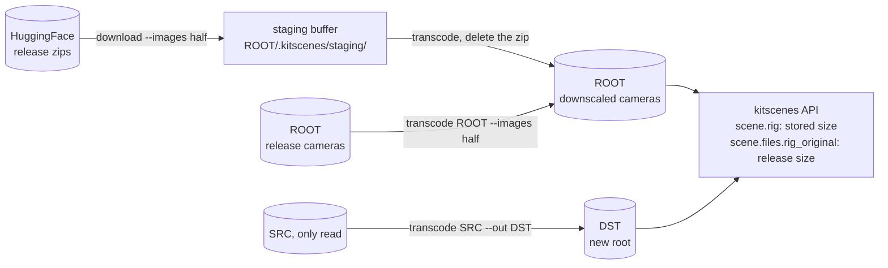

# Downscaled camera images (`kitscenes transcode`)

Keep the cameras at 1/2, 1/4 or 1/8 of their size to save disk. Read this page if you train at a fraction of the camera resolution.

**In short**

- The cameras are 9.2 TB of the 12.1 TB full download. With `--images half` the full download is ~4.4 TB.
- You can downscale while downloading, in place after a download, or into a new root.
- Your code does not change: `calib.json` stays as released, and `scene.rig` describes the stored images ([The API](#the-api)).
- Info files for training keep the release geometry (`scene.files.rig_original`); the kitscenes-mmdet3d loaders handle the rest ([Training code](#training-code)).

```bash
kitscenes download ROOT --splits train --images half --dry-run       # sizes first
kitscenes download ROOT --splits train --images half                 # downscaled while downloading
```



The release images are JPEGs at about quality 98 with full colour resolution (4:4:4): 3504×2272 for the ring cameras, 5856×3104 for `camera_base_front_center`. All commands:

```bash
kitscenes download ROOT --splits train --images half                 # while downloading (staged, see below)
kitscenes transcode ROOT --images half                               # after a download, in place
kitscenes transcode ROOT --images quarter --cameras ring-cameras     # further down, some cameras only
kitscenes transcode SRC --out DST --images half                      # a new root (SRC is only read)
kitscenes download ROOT --images original                            # back to the release's images
kitscenes info ROOT                                                  # what is downscaled
```

## Recipes

`--images` takes a preset or `key=value` pairs:

| Recipe | Images | Size of the cameras (release: 9.17 TB) | Full download (12.1 TB with the release cameras) |
|---|---|---|---|
| `half` (default suggestion) | 1/2, q90, 4:2:0 | ~1.5 TB (6.3×) | ~4.4 TB |
| `quarter` | 1/4, q90, 4:2:0 | ~0.33 TB (28×) | ~3.2 TB |
| `eighth` | 1/8, q90, 4:2:0 | ~0.11 TB | ~3.0 TB |
| `full` | release size, q90, 4:2:0 | ~5.7 TB (1.6×) | ~8.6 TB |
| `half,quality=95` | 1/2, q95, 4:2:0 | ~2.4 TB (3.8×) | ~5.3 TB |
| `scale=1/4,quality=85,subsampling=4:4:4` | any combination | | |

- **Only power-of-two reductions** (1/2, 1/4, 1/8). Every camera's size divides by 8, so pixel grids and intrinsics stay exact, and the CPU decodes straight to the smaller size (JPEG DCT scaling). Model input sizes such as 800×450 stay a resize at load time ([`kitscenes.decode`](../kitscenes/decode.py), DALI).
- **Quality** (the re-encoding loss alone, over 4 scenes × 4 cameras):

  | Recipe | Luma PSNR, mean (worst frame) | SSIM |
  |---|---|---|
  | q90 4:2:0 | 42.4 dB (37.1 dB) | 0.960 |
  | q95 4:2:0 | 45.1 dB (41.8 dB) | 0.979 |

  q95 costs +63 % in size. Full colour resolution (4:4:4) costs +44 % and improves only colour (+3 dB). For texture-sensitive work (reconstruction, novel-view synthesis, depth) take q95 or the release's images.
- Reducing further from stored images works (`half` → `quarter`; the record keeps the history). A larger size, or a better quality at the same size, needs the release's images: `kitscenes download ROOT --images original`.

## While downloading

`kitscenes download --images RECIPE` fetches each camera zip of a scene into a staging buffer, `ROOT/.kitscenes/staging/`. It transcodes the zip into the scene folder and deletes it. A camera download waits while the buffer is full: `--staging-gb`, default 32. Peak disk is the final size plus the buffer. Everything else (lidars, metadata, labels) downloads unchanged.

- **The root remembers the recipe** per camera in `dataset_info.json`. Later downloads into the root apply it without `--images`. A different recipe for a camera is refused (exit code 2): make it smaller with `kitscenes transcode`, or go back with `--images original`.
- **The release's zips already in the root** (downloaded before `--images`) are transcoded in place, without a download.
- **Interruptions.** A camera counts as done only when its record is written, after the new zip is complete. The next run cleans the buffer and redoes what was missing.
- **`--update`.** A camera whose release zip changed is downloaded and transcoded again; the others stay. `--verify` checks a transcoded zip against the SHA-256 in its record.
- **`--extract` / `kitscenes extract`** unpack transcoded zips as well. They are checked against their record's SHA-256.

The transcoders keep up with the download: 16 CPU workers do about 300 ring images/s, a GPU 180–450.

## After a download, or into a new root

`kitscenes transcode ROOT --images RECIPE` works camera by camera, in place. Each new zip (or folder) is written next to the old one, then swapped in, so the extra disk is about one archive per running camera. Selection: `--splits`, `--scenes`, `--cities`, `--lidar`, `--where` and `--cameras` (names or presets such as `ring-cameras`).

`--out DST` writes a new root and only reads `ROOT`, for example from a shared copy to a local SSD. DST gets the selected scenes in the layout of the source (archives or extracted folders): the transcoded cameras, everything else copied as it is, and the top-level map folders. To change the layout, run `kitscenes extract` or [`kitscenes pack`](#packing-extracted-scenes-kitscenes-pack).

## Backends

| `--backend` | How | Speed at 1/2 |
|---|---|---|
| `cpu` | Pillow (libjpeg-turbo): DCT-scaled decode, encode; one process per `--jobs` (default up to 8) | about 19 ring images/s per core |
| `gpu` | NVIDIA DALI decodes and halves on the GPU (exact 2×2 box means); nvImageCodec encodes (GPU transform, CPU entropy coding); two worker processes per `--gpus` device (`--transcode-gpus` on `kitscenes download`) | 180–450 images/s per GPU (the 18 MP front camera is the slowest) |
| `auto` (default) | the GPU if DALI and nvImageCodec work, else the CPU | |

- **GPU install:** `pip install nvidia-dali-cuda120`, which brings nvImageCodec. DALI has no JPEG encoder, so encoding is nvImageCodec's.
- **Backends are not byte-identical.** They differ by a few grey levels (DCT scaling vs. box filter) at the same size. The record says which one wrote a camera.
- **nvImageCodec and torchvision.** In a process that imported `torchvision.io` first, nvImageCodec gets torchvision's older nvJPEG (same library name, `libnvjpeg.so.12`) and cannot encode on the GPU ("nvjpeg error #9"). The GPU workers are therefore fresh processes that load nvImageCodec first.
- **Scripts.** Like every program using `multiprocessing`, a script that calls `kitscenes.transcode` needs an `if __name__ == "__main__":` guard.

## The API

- **`calib.json` keeps the release calibration.** Each transcoded camera of a scene has a record `<scene>/.transcoded/<camera>.json` (`kitscenes.transcode.ImageVariant`: recipe, image size, release size, layout, the SHA-256 of the release zip it came from and of the new zip, backend, version).
- **`scene.rig` returns the cameras of the stored images:** `K` and `image_size` scaled as `Camera.scaled(1/reduce)` does. Projection, `SampleSpec` (`K` matches the image), `decode_cameras`, DALI and the viewer stay consistent. `scene.files.rig_original` is the release calibration, `scene.files.image_variants[camera]` the record.
- **`frame.image(camera, reduce=2)`** reduces the stored image (the rig describes the stored one).
- **Size check.** `frame.image` raises `kitscenes.errors.ImageSizeError` if an image does not have the size of `scene.rig`. Images resized by another tool have no record, so projections into them would be silently wrong.
- **Painting, seamseg labels and voxel maps** (`kitscenes.painting`, `kitscenes.mapping`) work on downscaled cameras: they project with the release calibration (the seamseg masks are at the release size) and sample the stored images by size ratio. Results are close to the release's, not identical.
- **Instance masks** keep the release size (`masks.image_size`). `masks.mask(i, size=...)`, `masks.label_images(size=...)` and `masks.scaled_boxes(size)` give them at a stored image's size.
- **The zip layout.** A transcoded zip keeps the archive format: stored, 4096-aligned, same member names. Its member offsets are in `.transcoded/<camera>.parquet`, which the API reads over the release's `index.parquet`. That file and every other one stay as released.

Python:

```python
from kitscenes.transcode import ImageRecipe, Transcoder, transcode, transcode_camera, transcode_jpeg

if __name__ == "__main__":
    result = transcode("ROOT", "half", splits=["train"], cameras=["ring-cameras"], backend="auto")
    small = transcode_jpeg(jpeg_bytes, ImageRecipe(reduce=4, quality=85))     # one image, CPU
    with Transcoder("gpu", gpus=[0, 1]) as t:                                    # a pool for many
        for jpeg, size_in, size_out in t.map(list_of_jpeg_bytes, ImageRecipe.parse("half")):
            ...
```

## Training code

Training pipelines that resize by a factor of the *loaded* image and apply the same factor to full-size projection matrices from their info files (MapTR-style `RandomScaleImageMultiViewImage(scales=[0.3])`) would be silently misaligned on downscaled images. [kitscenes-mmdet3d](https://github.com/KIT-MRT/kitscenes-mmdet3d) 0.2.0 handles this: the loader gives every view its release size (`image_size="release"`, the default), so `img_shape` and the projection matrices are those of the release. The deferred decoders resize from the stored image straight to the pipeline's size; the CPU decoder upsamples to the release size. Read through the API (`frame.image`, `SampleSpec`, `scene.rig`) and nothing needs to change.

Info files (pkl) should hold the release geometry, so that one file serves the release and every downscaled copy: a converter that runs on a downscaled root takes the cameras from `scene.files.rig_original`, not `scene.rig`.

## Packing extracted scenes (`kitscenes pack`)

`kitscenes.pack` is the release's archive writer. `kitscenes pack SRC --out DST` turns the extracted scenes of a root (`SRC/data/<split>/<scene_id>/`) into the archive format: one zip per component, `index.parquet`, loose metadata. Repacking an unmodified extracted component gives the release's zip byte for byte, the same SHA-256 as in the manifest.

```python
from kitscenes.pack import pack_scene, write_aligned_zip
files = pack_scene("extracted/data/train/<scene>", "packed/data/train/<scene>")   # [PackedFile(path, component, sha256, size)]
```
